# Lev Space

**A booking and management web app built for a real barbershop — so the barber can spend his day cutting hair, not answering messages.**

[](https://github.com/Marco17Cherubini/Lev-Space/actions/workflows/ci.yml)


> The user interface is in Italian, as it is used daily by an Italian barbershop and its clients.

| Entrance                                                                                                                 | Pick your turn                                                                                                       | Your ticket                                                                                       | The barber's agenda                                                                                          |
| ------------------------------------------------------------------------------------------------------------------------ | -------------------------------------------------------------------------------------------------------------------- | ------------------------------------------------------------------------------------------------- | ------------------------------------------------------------------------------------------------------------ |
| 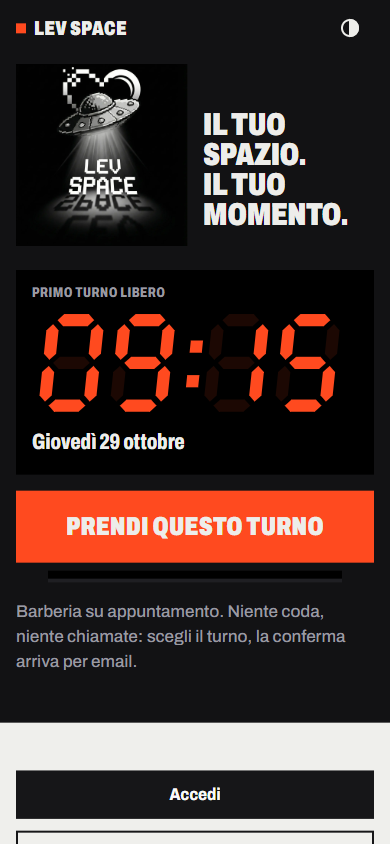 | 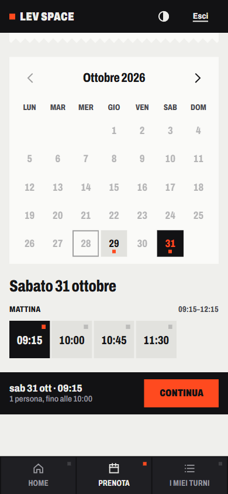 | 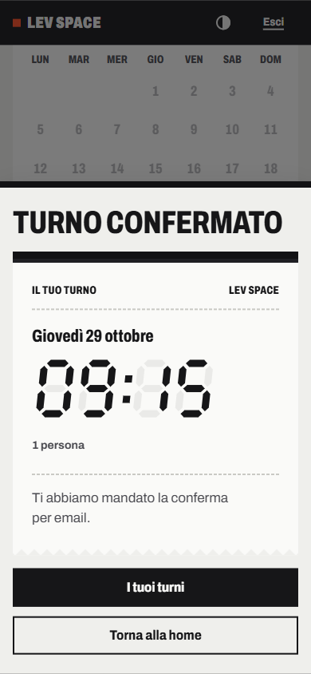 | 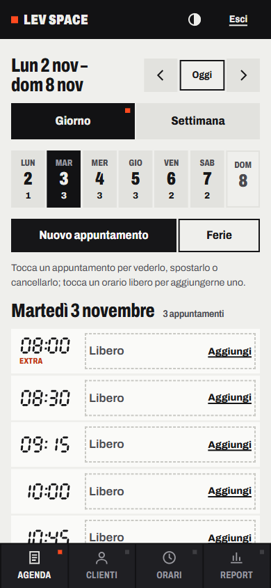 |

---

## The story

### Context

Lev Space was born from a very concrete discomfort. The barber behind it was spending his days doing two jobs at once: cutting hair, and acting as his own receptionist. About **30 people a day** wrote or called him to book, move or cancel an appointment, and every one of them expected an answer.

### The problem

A typical day was **about 8 hours of haircuts plus at least 3 more hours of organising**: replying to messages, checking which slots were still free, rescheduling, remembering who comes every two weeks. Those extra hours came out of his private life, and his work–life balance had dropped to almost nothing.

### How we solved it

We designed, built and iteratively improved a web app that takes the whole booking conversation off his phone:

- **clients book themselves**, 24/7, on a calendar that only shows the slots that are really free;
- **the barber manages everything from one admin panel**: agenda, regular clients, opening hours, holidays and statistics;
- **the rules of the shop are encoded in the app** — opening hours per day, group appointments, recurring clients, VIP treatment and blocks for disrespectful users — so they no longer need to be enforced by hand.

### Results

The app is in daily use and has grown with the shop:

- **155 registered clients** book in rotation (12 of them are VIP);
- in peak months the calendar handled **197 cuts between 28 May and 26 June** and **210 cuts between 27 February and 28 March**;
- that is **around 7 appointments a day on average**, with best days reaching **14–15 cuts** — all booked without a single message to the barber.

| Report                                                                                                                             | Clients                                                                                    |
| ---------------------------------------------------------------------------------------------------------------------------------- | ------------------------------------------------------------------------------------------ |
| 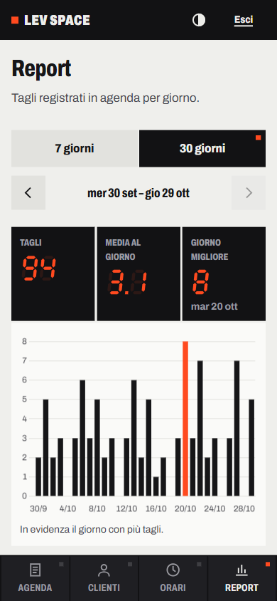 | 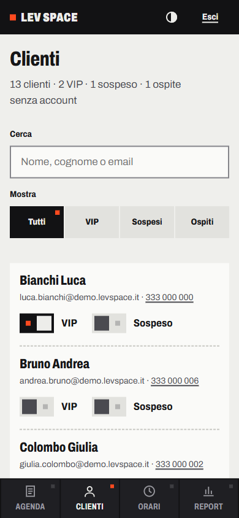 |

_The figures above are the shop's real ones; the screenshots show the current interface with demo data, so no client data is published._

---

## The 2026 redesign: «Il tuo turno»

Lev Space replaces the queue and the phone calls, so its interface is built from the object of that ritual: the **take-a-number dispenser** (_eliminacode_). Times are shown on **7-segment displays** with the unlit segments faintly visible, the day is a **row of keys** split into morning and afternoon, and a confirmed booking is a **thermal ticket** that comes out of a slot. One typeface (Archivo, condensed for signage), black panel, thermal paper and a single LED red. The logo, a pixel-art UFO drawn on black, finally sits on the black it was made for.

A side-by-side comparison with the previous interface is in [docs/STATO.md](docs/STATO.md#9-prima-e-dopo).

What changed for the people who use it:

- **Clients** book in one page (how many, day, turn, confirm) instead of a modal plus a separate summary page; a group of 2–3 lights 2–3 consecutive keys, so "consecutive slots" explains itself; the first free turn is bookable straight from the entrance; long-period bookings are confirmed all at once or not at all.
- **The barber** gets a day agenda with a week strip on the phone (and the full week with drag & drop on desktop), an explicit **"Sposta appuntamento"** action everywhere, holidays by selection, states readable by shape (solid, dashed, hatched, double rule) rather than colour, and a live "adesso" marker.

Design direction, tokens and components: [DESIGN.md](DESIGN.md) · product context: [PRODUCT.md](PRODUCT.md) · plan, backend fixes and verification: [docs/PLAN.md](docs/PLAN.md), [docs/STATO.md](docs/STATO.md).

---

## What makes it different

Lev Space is not a generic booking widget: every feature comes from how this specific shop works.

### "Il solito?" — rebook your usual appointment in one tap

When a returning client opens the app, Lev Space takes their **last appointment** and proposes **the same weekday and time** in the first of the next three weeks where that slot is free and the client has nothing booked yet: _"Il solito, Luca?"_ ("The usual, Luca?"). One tap opens the confirmation with day and time already chosen.

### Recurring appointments

Many clients come at a fixed rhythm. From the admin agenda the barber can turn an appointment into a **series every 1, 2 or 3 weeks for up to 12 months**. Dates that are already taken or fall on a holiday are skipped (never overwritten) and the summary says how many were created. Later he can cancel **a single occurrence or the whole series**.

### Opening hours the barber can change himself

Opening days, morning and afternoon shifts and the VIP extra hours are edited from the **Orari** page — no code, no deploy. Each shift is previewed as its row of 45-minute keys; the server derives the slots from start and end, so two appointments can never overlap.

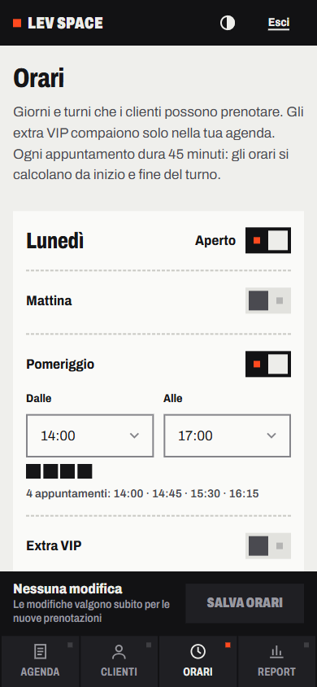

### VIP clients and extra hours

Regular and loyal clients can be marked as **VIP**. Outside the standard hours the barber can open **extra VIP hours** (early morning and evening). They appear only in the admin agenda, marked "Extra"; clients cannot book them online.

### BAN for disrespectful users

Clients who repeatedly skip appointments can be **suspended** from the client list (with a confirmation). A banned user can no longer log in, any open session stops working, and they cannot book as a guest with the same email either.

### Group appointments

A father with two kids, or three friends: clients can book for **up to 3 people** and get **consecutive slots** — never split across the lunch break.

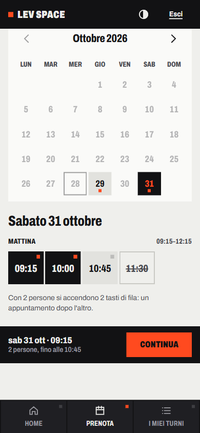

### Guest booking without an account

First-time clients can book with just **name, surname and email**. If they register later with the same email, their guest bookings move into the new account.

### Long-period bookings

A client can reserve **one appointment per week for 4, 8 or 12 weeks**, choosing week by week or repeating the first choice. All weeks are confirmed together: if one is no longer free, nothing is booked and the app shows which week to change.

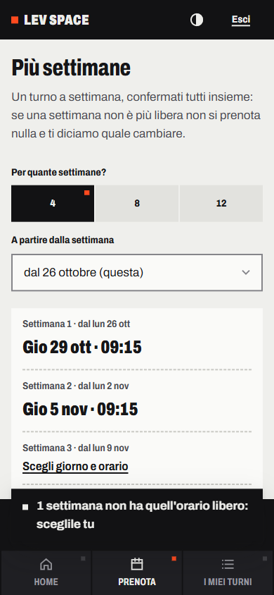

### An agenda built for the chair

On the phone the barber sees **one day at a time** with a week strip; on desktop the **whole week**, with **drag & drop**. Every move is also available as an explicit **"Sposta appuntamento"** action (no gesture required), holidays are set by selecting slots, clients are filled in by searching their name, and a **weekly/monthly report** has history navigation and a data table.

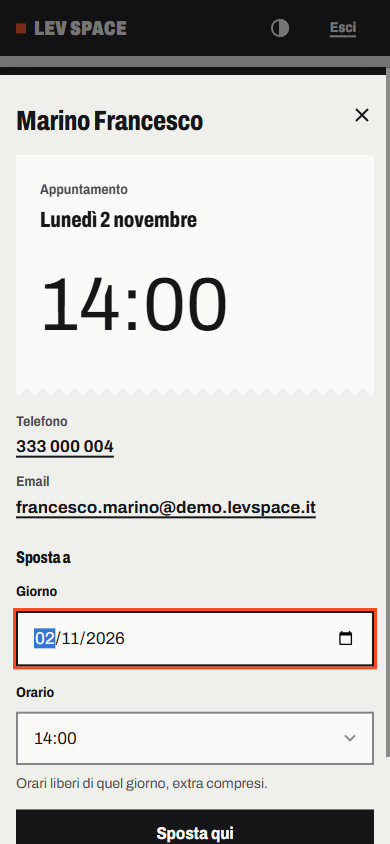

Also included: email confirmations and password reset (via Resend) in the same ticket style, and light ("thermal paper") and dark ("panel") themes designed separately.

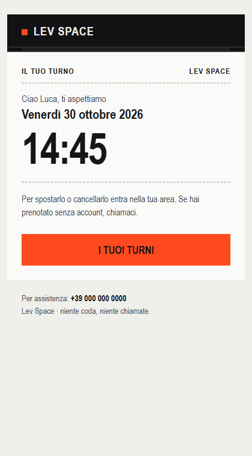

---

## Under the hood

### Tech stack

| Layer    | Choice                                               | Why                                                                                                                                |
| -------- | ---------------------------------------------------- | ---------------------------------------------------------------------------------------------------------------------------------- |
| Server   | Node.js + Express 4                                  | Small, well-known, easy to deploy on a single instance                                                                             |
| Database | SQLite via [sql.js](https://sql.js.org) (WASM)       | Zero native build, one file on a Railway volume; atomic writes, and memory, file and HTTP response stay consistent if a save fails |
| Auth     | JWT in an `httpOnly`, `SameSite=Lax` cookie + bcrypt | No token in JavaScript reach; sessions die on logout, ban or password change                                                       |
| Frontend | HTML, CSS and vanilla JavaScript                     | No build step; one self-hosted variable font; the 7-segment display is drawn in SVG                                                |
| Email    | Resend                                               | Booking confirmations and password reset                                                                                           |
| Charts   | Chart.js (served locally, report page only)          | Admin reports                                                                                                                      |
| Tests    | `node:test` (built into Node)                        | No test framework to install                                                                                                       |

### Architecture

```
frontend/ (static pages, vanilla JS)          server/
  js/utils.js       apiRequest, dates, toast    server.js        startup: config checks, DB, listen
  js/layout.js      navigation, logout, auth    app.js           middleware, CSRF guard, routes
  js/components/    display (7 segments),       routes/          auth · bookings · admin · pages (HTTP only)
                    booking picker, sheet       bookingService   slots, bookings, groups, series, agenda
  js/<page>.js      one script per page         authService      accounts, sessions, revocation, VIP/BAN
  styles/           app · pages · admin         holidayService · reportService · businessHours · emailService
          fetch JSON  ───────────────────▶      database.js      sql.js wrapper, atomic save, transactions
```

Routes only translate HTTP; the rules of the shop live in the services, which throw typed `HttpError`s handled in one place. The admin agenda receives its slots, bookings and holidays from `GET /api/admin/schedule`, so the browser never re-implements the opening-hours rules.

### Quality and security

- **102 automated tests** run against the real server and a temporary database: slots, bookings, groups, series, holidays, auth, sessions, bans, rate limiting, persistence failures, migrations and startup checks.
- **Idempotent bookings**: a double tap or a retry after a lost response returns the existing booking instead of an error; long-period bookings are all-or-nothing.
- **CSRF in depth**: state-changing requests must come from the same origin (`Origin` / `Sec-Fetch-Site`) and carry JSON, on top of `SameSite=Lax`.
- **Sessions**: tokens carry a `jti` and are revoked on logout; bans and password changes end open sessions; reset links are single-use and expire after an hour.
- **Persistence**: if a save fails, the in-memory database rolls back to what is on disk and the client gets an error; startup refuses to run with duplicate bookings on the same slot (`npm run db:check` lists them) or with a failed migration.
- **Content Security Policy** with no inline scripts, HTML escaping of every user-provided value, rate limiting on login and guest bookings.
- **Accessibility** (WCAG 2.2 AA): keyboard-operable calendar and keys, native `<dialog>` sheets with focus management and Back-button support, touch targets of at least 44 px, AA contrast in both themes, no horizontal scroll at 200 % text, reduced-motion support.
- ESLint + Prettier, and a GitHub Actions workflow that runs lint, formatting check and tests on every push.

---

## Getting started

Requirements: **Node.js 18 or newer**.

```bash
git clone https://github.com/Marco17Cherubini/Lev-Space.git
cd Lev-Space
npm install
cp .env.example .env        # on Windows: copy .env.example .env
```

Open `.env` and set at least:

- `JWT_SECRET` — a long random string (`node -e "console.log(require('crypto').randomBytes(64).toString('hex'))"`);
- `ADMIN_EMAIL` and `ADMIN_PASSWORD` — the admin account created on first start.

Then load the demo data and start the app:

```bash
npm run seed    # demo clients, two months of history, upcoming bookings
npm start       # http://localhost:3000
```

Demo logins: the admin from your `.env`, or any demo client such as `luca.bianchi@demo.levspace.it` / `Demo12345!`.

### Useful scripts

| Command                                 | What it does                                         |
| --------------------------------------- | ---------------------------------------------------- |
| `npm run dev`                           | Start with auto-reload (nodemon)                     |
| `npm test`                              | Run the test suite                                   |
| `npm run lint` / `npm run format:check` | ESLint and Prettier checks                           |
| `npm run seed`                          | Fill an **empty** database with demo data            |
| `npm run db:check`                      | List bookings sharing the same slot (read-only)      |
| `npm run backup`                        | Copy the database to `BACKUP_DIR` (keeps the last 4) |
| `npm run start:prod`                    | Start in production with PM2                         |

### Configuration

| Variable                                      | Required    | Default                    | Purpose                                                        |
| --------------------------------------------- | ----------- | -------------------------- | -------------------------------------------------------------- |
| `JWT_SECRET`                                  | yes         | —                          | Signs session tokens; the server refuses to start without it   |
| `ADMIN_EMAIL`, `ADMIN_PASSWORD`               | first start | —                          | Admin account created when none exists                         |
| `PORT`                                        | no          | `3000`                     | HTTP port                                                      |
| `NODE_ENV`                                    | no          | `development`              | `production` enables secure cookies and proxy trust            |
| `BASE_URL`                                    | no          | `http://localhost:3000`    | Public URL used in password-reset emails and the origin check  |
| `DATABASE_PATH`                               | no          | `database/database.sqlite` | SQLite file (e.g. `/data/database.sqlite` on a Railway volume) |
| `RESEND_API_KEY`, `EMAIL_FROM`                | no          | —                          | Email sending; without a key emails are skipped                |
| `TZ`                                          | no          | `Europe/Rome`              | Time zone of slots and bookings                                |
| `RATE_LIMIT_AUTH_MAX`, `RATE_LIMIT_GUEST_MAX` | no          | `20`, `10`                 | Requests per IP every 15 minutes                               |
| `BACKUP_DIR`                                  | no          | `backups/`                 | Destination of `npm run backup`                                |

### Deployment

Lev Space runs on [Railway](https://railway.app) as a single instance: mount a volume, point `DATABASE_PATH` to it, set `NODE_ENV=production`, `BASE_URL` and the variables above. Because sql.js keeps the database in memory and saves it to one file, the app must run as **one process** (no cluster mode). Run `npm run db:check` against the production database before deploying a version that enforces the one-booking-per-slot check at startup.

---

## Development

Before pushing, run `npm run lint`, `npm run format:check` and `npm test` — the same checks run in CI on Node 20 and 22.

- **Server**: routes in `server/routes/` only translate HTTP; the rules of the shop live in the services, which throw `HttpError(status, message)`. Multi-row writes go through `withTransaction()`.
- **Frontend**: one script per page in `frontend/js/`, shared helpers in `utils.js` and `layout.js`, components in `js/components/` (segment display, booking picker, sheet). No inline scripts or `onclick`: the Content Security Policy blocks them, and every user-provided value goes through `escapeHtml()`.
- **CSS**: `styles/app.css` (tokens and components) plus `pages.css` or `admin.css`. Colours come from semantic tokens so both themes keep AA contrast; see [DESIGN.md](DESIGN.md).
- User-facing text and code comments are in Italian; commits follow Conventional Commits.

## Known limitations

- **Single instance**: sql.js keeps the database in memory and saves it to one file, so the app must run as one process.
- **Guest emails are not verified**: guest bookings are rate-limited and cannot use the email of a registered account, but the address itself is not confirmed.
- **Tokens issued before this version** cannot be revoked on logout and simply expire within 7 days.
- **Not yet tested on real devices**: verified in Chromium with mobile emulation; Safari/WebKit and real iPhone/Android checks are listed in [docs/STATO.md](docs/STATO.md).

## Project structure

```
config/          default opening hours and settings
docs/            plan, verification log, screenshots (before / after)
frontend/        HTML pages, fonts/, js/ (components/), styles/
server/          app, routes, services, database, seed, backup and db-check scripts
test/            node:test suites and helpers
DESIGN.md        visual system · PRODUCT.md  product context
```

## Author

Designed and built by **Marco Cherubini** — [github.com/Marco17Cherubini](https://github.com/Marco17Cherubini).

## License

[MIT](LICENSE) © Marco Cherubini
