# Lev Space

**A booking and management web app built for a real barbershop — so the barber can spend his day cutting hair, not answering messages.**

[](https://github.com/Marco17Cherubini/Lev-Space/actions/workflows/ci.yml)


> The user interface is in Italian, as it is used daily by an Italian barbershop and its clients.

---

## The story

### Context

Lev Space was born from a very concrete discomfort. The barber behind it was spending his days doing two jobs at once: cutting hair, and acting as his own receptionist. About **30 people a day** wrote or called him to book, move or cancel an appointment, and every one of them expected an answer.

### The problem

A typical day was **about 8 hours of haircuts plus at least 3 more hours of organising**: replying to messages, checking which slots were still free, rescheduling, remembering who comes every two weeks. Those extra hours came out of his private life, and his work–life balance had dropped to almost nothing.

### How we solved it

We designed, built and iteratively improved a web app that takes the whole booking conversation off his phone:

- **clients book themselves**, 24/7, on a calendar that only shows the slots that are really free;
- **the barber manages everything from one admin panel**: weekly calendar, regular clients, opening hours, holidays and statistics;
- **the rules of the shop are encoded in the app** — opening hours per day, group appointments, recurring clients, VIP treatment and blocks for disrespectful users — so they no longer need to be enforced by hand.

For a client, booking takes three steps: pick a free day and time, confirm, and receive the confirmation email.

| 1. Pick day and time                                                                                       | 2. Confirm                                                                         | 3. Confirmation email                                                                           |
| ---------------------------------------------------------------------------------------------------------- | ---------------------------------------------------------------------------------- | ----------------------------------------------------------------------------------------------- |
| 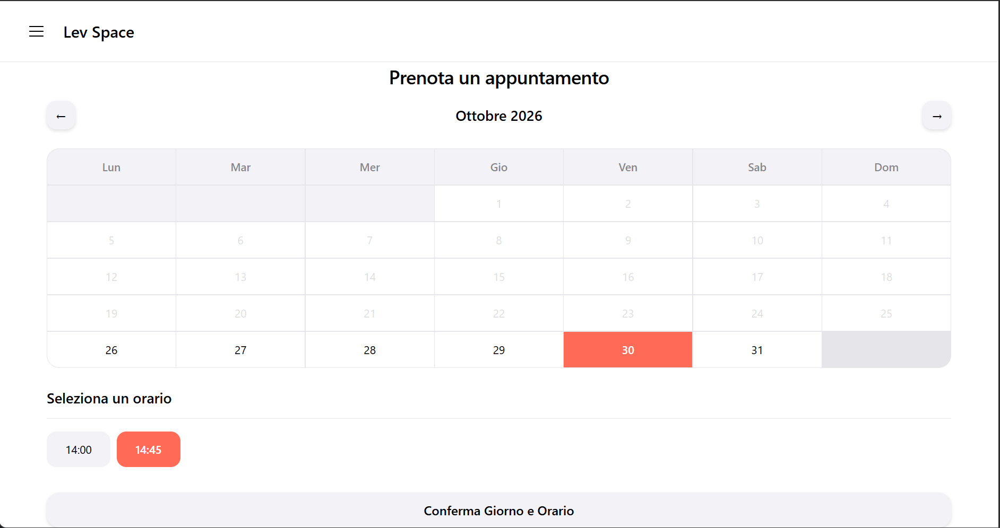 | 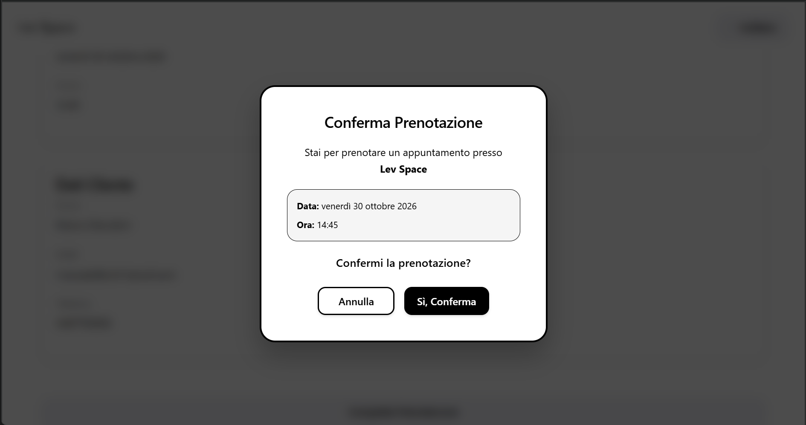 | 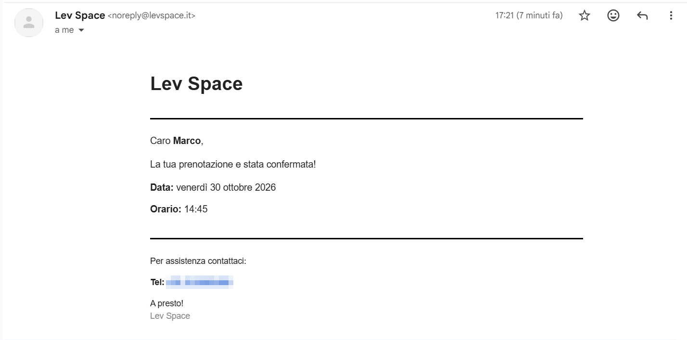 |

### Results

The app is in daily use and has grown with the shop:

- **155 registered clients** book in rotation (12 of them are VIP);
- in peak months the calendar handled **197 cuts between 28 May and 26 June** and **210 cuts between 27 February and 28 March**;
- that is **around 7 appointments a day on average**, with best days reaching **14–15 cuts** — all booked without a single message to the barber.

| Peak month — June                                                                                             | Peak month — March                                                                                                   |
| ------------------------------------------------------------------------------------------------------------- | -------------------------------------------------------------------------------------------------------------------- |
| 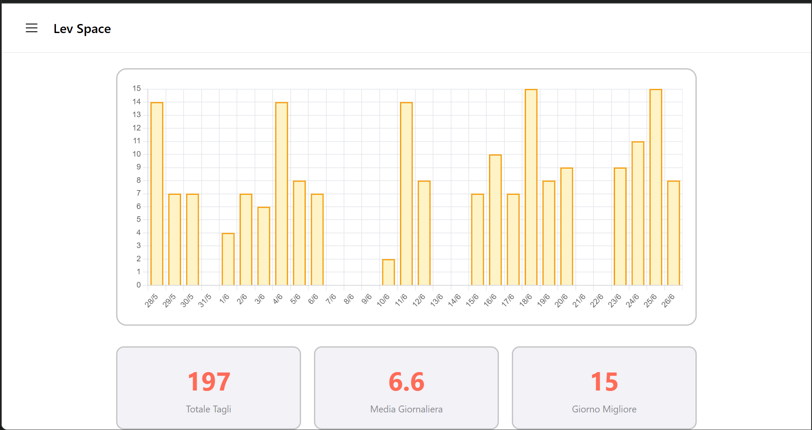 | 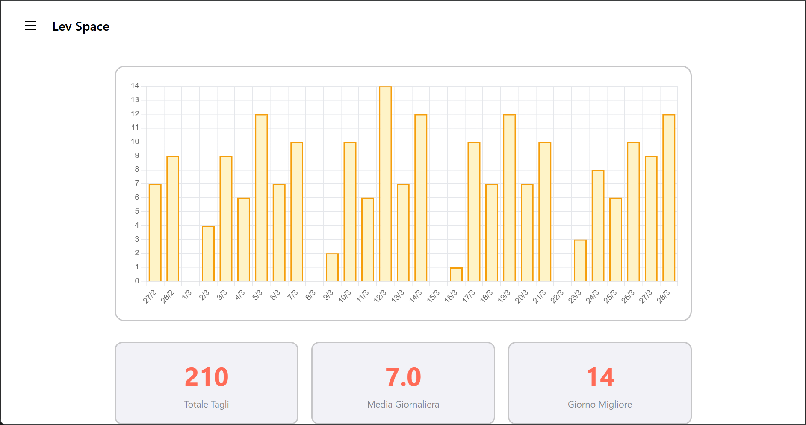 |

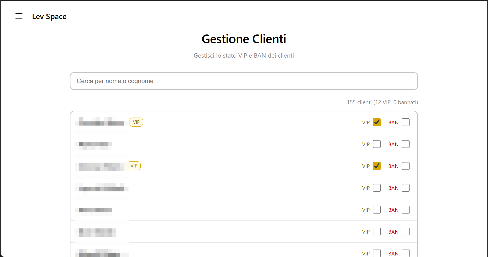

---

## What makes it different

Lev Space is not a generic booking widget: every feature comes from how this specific shop works.

### "Il solito?" — rebook your usual appointment in one tap

When a returning client opens the calendar, Lev Space looks at their last appointment, checks whether **the same day and time one week later** is still free, and asks: _"Il solito Luca?"_ ("The usual, Luca?"). One tap fills in date and time, and a final confirmation books it. It reproduces the most common sentence the barber used to hear on the phone.

### Recurring appointments

Many clients come at a fixed rhythm. From the admin calendar the barber can turn an appointment into a **series every 1, 2 or 3 weeks for up to 12 months**. Dates that are already taken or fall on a holiday are skipped (never overwritten) and the summary says how many were created. Later he can cancel **a single occurrence or the whole series**.

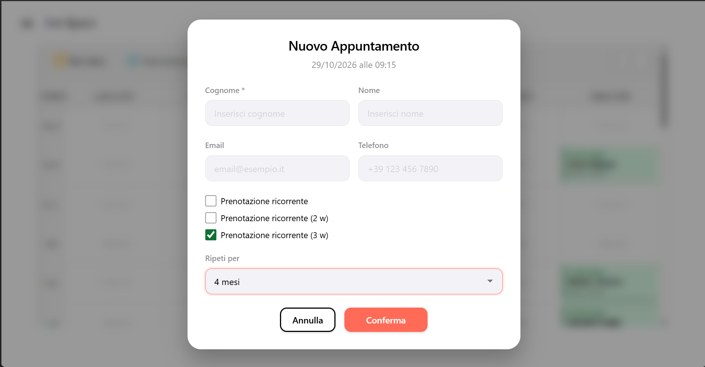

### Opening hours the barber can change himself

Opening days, morning and afternoon shifts and their slots are edited from the **Gestione Orari** page — no code, no deploy. The client calendar updates immediately, and the input is validated so a mistake can never close the shop by accident.

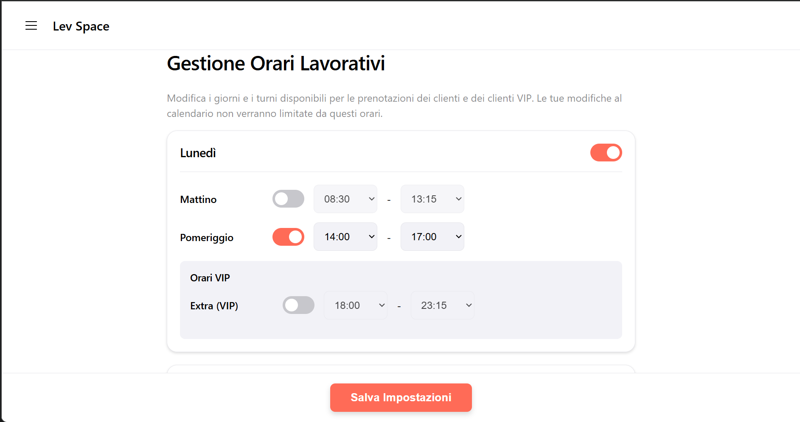

### VIP clients and extra hours

Regular and loyal clients can be marked as **VIP**. Outside the standard hours the barber can open **extra VIP hours** (early morning and evening, set in the same opening-hours page). They appear only in the admin calendar — like the 08:00 appointment in the calendar below — and clients cannot book them online: the barber uses them to fit in his VIPs personally.

### BAN for disrespectful users

Clients who repeatedly skip appointments can be **banned** with one click from the client list. A banned user can no longer log in, any open session stops working, and they cannot book as a guest with the same email either. VIP and BAN are both managed from the client list shown in [Results](#results).

### Group appointments

A father with two kids, or three friends: clients can book for **up to 3 people** and get **consecutive slots** — never split across the lunch break.

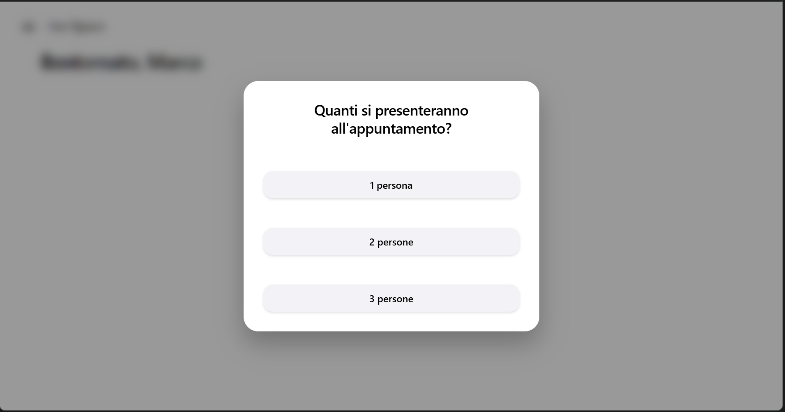

### Guest booking without an account

First-time clients can book with just **name, surname and email**. If they register later with the same email, their guest bookings move into the new account.

### Long-period bookings

A client can reserve **one appointment per week for 4, 8 or 12 weeks** in a single flow, choosing day and time week by week.

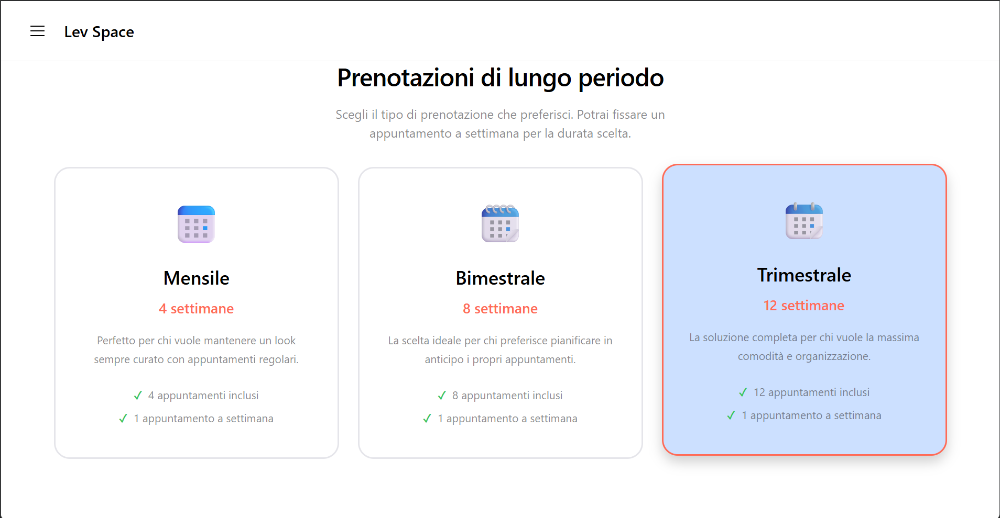

### A calendar built for the chair

The admin weekly calendar supports **drag & drop** to move appointments (with **long-press on mobile**, between two cuts), **drag-select holidays** across slots, client **autocomplete** when adding a booking, and a **weekly/monthly report** with history navigation.

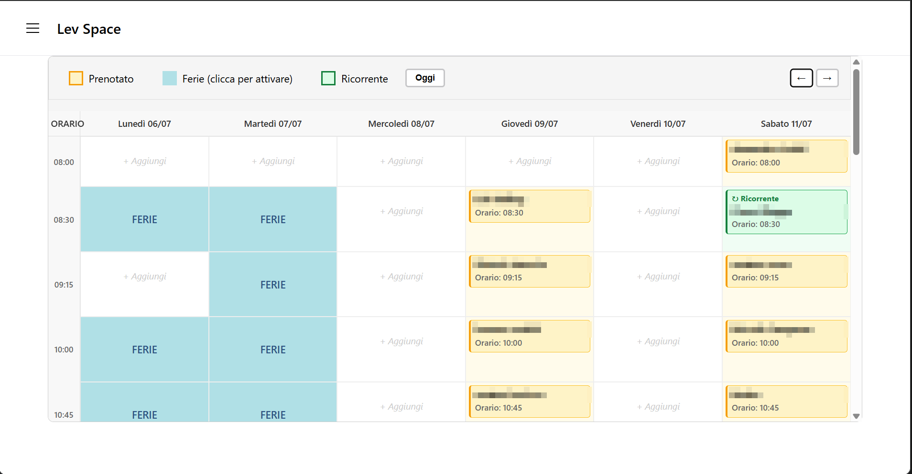

Also included: email confirmations and password reset (via Resend), and a light/dark theme with an animated switch.

---

## Under the hood

### Tech stack

| Layer    | Choice                                               | Why                                                                                                             |
| -------- | ---------------------------------------------------- | --------------------------------------------------------------------------------------------------------------- |
| Server   | Node.js + Express 4                                  | Small, well-known, easy to deploy on a single instance                                                          |
| Database | SQLite via [sql.js](https://sql.js.org) (WASM)       | Zero native build, one file on a Railway volume; writes are atomic and multi-row operations run in transactions |
| Auth     | JWT in an `httpOnly`, `SameSite=Lax` cookie + bcrypt | No token in JavaScript reach; sessions die on ban or password change                                            |
| Frontend | HTML, CSS and vanilla JavaScript                     | No build step; design tokens and modular CSS keep it maintainable                                               |
| Email    | Resend                                               | Booking confirmations and password reset                                                                        |
| Charts   | Chart.js (served locally)                            | Admin reports                                                                                                   |
| Tests    | `node:test` (built into Node)                        | No test framework to install                                                                                    |

### Architecture

```
frontend/ (static pages, vanilla JS)         server/
  js/utils.js      apiRequest, helpers         server.js        startup: config checks, DB, listen
  js/layout.js     menu, logout, auth guard    app.js           middleware, security headers, routes
  js/<page>.js     one script per page         routes/          auth · bookings · admin · pages (HTTP only)
  styles/          tokens → base → components  bookingService   slots, bookings, groups, recurring series
                   → layout → pages            authService      accounts, sessions, VIP/BAN, password reset
                                               holidayService · reportService · businessHours · emailService
          fetch JSON  ───────────────────▶     database.js      sql.js wrapper, atomic save, transactions
```

Routes only translate HTTP; the rules of the shop live in the services, which throw typed `HttpError`s (400/401/403/404/409) handled in one place.

### Quality and security

- **75 automated tests** run against the real server and a temporary database: slot calculation, bookings, groups, recurring series, holidays, auth, sessions, bans, rate limiting, persistence and database migrations.
- **Content Security Policy** with no inline scripts, HTML escaping of every user-provided value, JSON-only API (no CSRF via forms), rate limiting on login and guest bookings, single-use password-reset links.
- **Accessibility** (WCAG 2.2): semantic landmarks, keyboard-operable calendars, accessible dialogs with focus management, AA colour contrast in both themes, reduced-motion support.
- ESLint + Prettier, and a GitHub Actions workflow that runs lint, formatting check and tests on every push.

---

## Getting started

Requirements: **Node.js 18 or newer**.

```bash
git clone https://github.com/Marco17Cherubini/Lev-Space.git
cd Lev-Space
npm install
cp .env.example .env        # on Windows: copy .env.example .env
```

Open `.env` and set at least:

- `JWT_SECRET` — a long random string (`node -e "console.log(require('crypto').randomBytes(64).toString('hex'))"`);
- `ADMIN_EMAIL` and `ADMIN_PASSWORD` — the admin account created on first start.

Then load the demo data and start the app:

```bash
npm run seed    # demo clients, two months of history, upcoming bookings
npm start       # http://localhost:3000
```

Demo logins: the admin from your `.env`, or any demo client such as `luca.bianchi@demo.levspace.it` / `Demo12345!`.

### Useful scripts

| Command                                 | What it does                                         |
| --------------------------------------- | ---------------------------------------------------- |
| `npm run dev`                           | Start with auto-reload (nodemon)                     |
| `npm test`                              | Run the test suite                                   |
| `npm run lint` / `npm run format:check` | ESLint and Prettier checks                           |
| `npm run seed`                          | Fill an **empty** database with demo data            |
| `npm run backup`                        | Copy the database to `BACKUP_DIR` (keeps the last 4) |
| `npm run start:prod`                    | Start in production with PM2                         |

### Configuration

| Variable                                      | Required    | Default                    | Purpose                                                        |
| --------------------------------------------- | ----------- | -------------------------- | -------------------------------------------------------------- |
| `JWT_SECRET`                                  | yes         | —                          | Signs session tokens; the server refuses to start without it   |
| `ADMIN_EMAIL`, `ADMIN_PASSWORD`               | first start | —                          | Admin account created when none exists                         |
| `PORT`                                        | no          | `3000`                     | HTTP port                                                      |
| `NODE_ENV`                                    | no          | `development`              | `production` enables secure cookies and proxy trust            |
| `BASE_URL`                                    | no          | `http://localhost:3000`    | Public URL used in password-reset emails                       |
| `DATABASE_PATH`                               | no          | `database/database.sqlite` | SQLite file (e.g. `/data/database.sqlite` on a Railway volume) |
| `RESEND_API_KEY`, `EMAIL_FROM`                | no          | —                          | Email sending; without a key emails are skipped                |
| `TZ`                                          | no          | `Europe/Rome`              | Time zone of slots and bookings                                |
| `RATE_LIMIT_AUTH_MAX`, `RATE_LIMIT_GUEST_MAX` | no          | `20`, `10`                 | Requests per IP every 15 minutes                               |
| `BACKUP_DIR`                                  | no          | `backups/`                 | Destination of `npm run backup`                                |

### Deployment

Lev Space runs on [Railway](https://railway.app) as a single instance: mount a volume, point `DATABASE_PATH` to it, set `NODE_ENV=production` and the variables above. Because sql.js keeps the database in memory and saves it to one file, the app must run as **one process** (no cluster mode).

---

## Development

Before pushing, run `npm run lint`, `npm run format:check` and `npm test` — the same checks run in CI on Node 20 and 22.

- **Server**: routes in `server/routes/` only translate HTTP; the rules of the shop live in the services, which throw `HttpError(status, message)`. Multi-row writes go through `withTransaction()`.
- **Frontend**: one script per page in `frontend/js/`, shared helpers in `utils.js` (`apiRequest`, `escapeHtml`, `showToast`) and `layout.js` (menu, logout, `requireAuth`). No inline scripts or `onclick`: the Content Security Policy blocks them, and every user-provided value goes through `escapeHtml()`.
- **CSS**: `tokens → base → components → layout → pages`, imported by `styles.css`. Colours come from semantic tokens so both themes keep AA contrast.
- User-facing text and code comments are in Italian; commits follow Conventional Commits.

## Known limitations

- **Single instance**: sql.js keeps the database in memory and saves it to one file, so the app must run as one process. Moving to a server-based database would be the next step for horizontal scaling.
- **Guest emails are not verified**: guest bookings are rate-limited and cannot use the email of a registered account, but the address itself is not confirmed.
- **Long-period bookings** are created one week at a time: if a later week fails, the client sees the error but the weeks already confirmed stay booked.
- **Sessions issued before the password-change check** remain valid until they expire (7 days).

## Project structure

```
config/        default opening hours and settings
docs/images/   screenshots used in this README
frontend/      HTML pages, js/, styles/ (tokens, base, components, layout, pages)
server/        app, routes, services, database, seed and backup scripts
test/          node:test suites and helpers
```

## Author

Designed and built by **Marco Cherubini** — [github.com/Marco17Cherubini](https://github.com/Marco17Cherubini).

## License

[MIT](LICENSE) © Marco Cherubini
